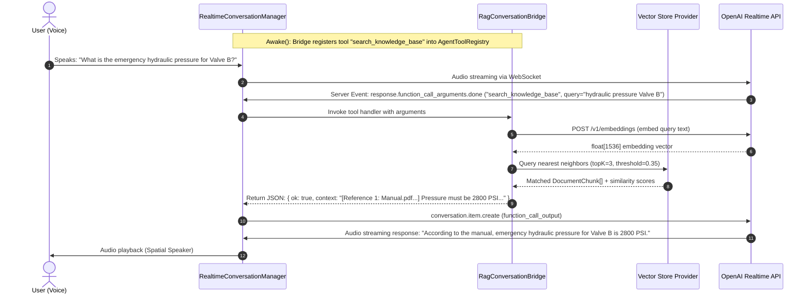
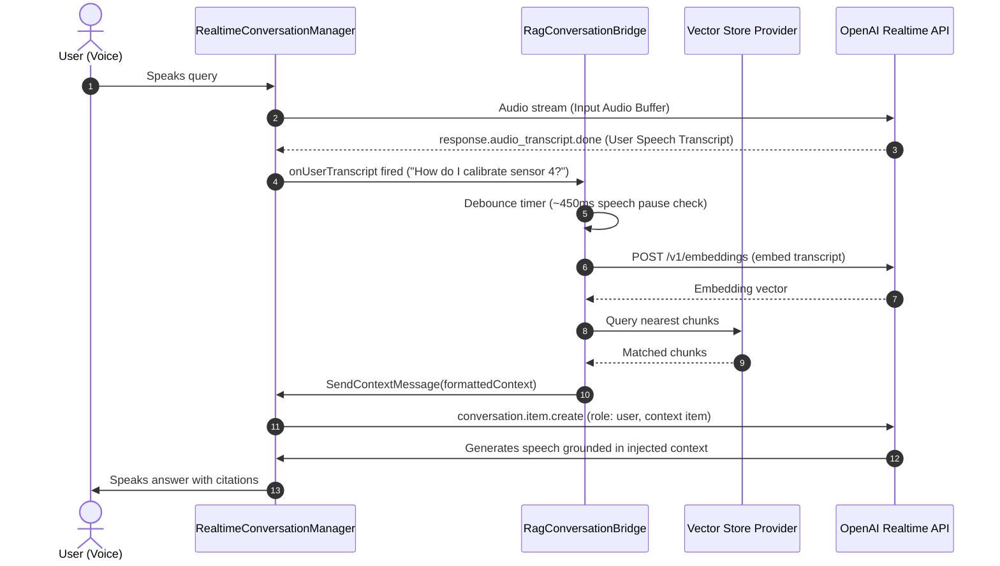

# OpenAI Real-time Conversational AI - RAG & Vector Knowledge Base

A complete guide to integrating **Retrieval-Augmented Generation (RAG)** into OpenAI real-time voice conversations and XR/gameplay systems using `com.convai.openai`.

---

## Table of Contents

1. [Overview & Architecture](#1-overview--architecture)
   - [What is RAG in Realtime Voice AI?](#what-is-rag-in-realtime-voice-ai)
   - [Retrieval Modes: Agentic Tool Call vs. Proactive Context Injection](#retrieval-modes)
   - [Architecture & Sequence Workflows](#architecture--sequence-workflows)
2. [Supported Vector Backends](#2-supported-vector-backends)
   - [Backend Comparison Matrix](#backend-comparison-matrix)
   - [Local Baked Asset (100% Offline, Zero Setup, Meta Quest Ready)](#backend-1-local-baked-asset)
   - [Supabase pgvector (Cloud PostgreSQL)](#backend-2-supabase-pgvector)
   - [Pinecone Serverless (Vector & Document Schema)](#backend-3-pinecone-serverless)
   - [Qdrant (Cloud & Self-Hosted)](#backend-4-qdrant-cloud--self-hosted)
3. [Knowledge Base Manager Editor Window](#3-knowledge-base-manager-editor-window)
   - [Window Overview & Navigation](#window-overview--navigation)
   - [Supported Document Formats](#supported-document-formats)
   - [Document Ingestion Pipeline](#document-ingestion-pipeline)
   - [Live In-Editor Query Tester](#live-in-editor-query-tester)
4. [Runtime Integration](#4-runtime-integration)
   - [RagConversationBridge Component](#ragconversationbridge-component)
   - [Agentic Tool Calling Mode](#mode-1-agentic-tool-calling-ragretrievalmodeagentictoolcall)
   - [Proactive Context Injection Mode](#mode-2-proactive-context-injection-ragretrievalmodeproactivecontextinjection)
   - [Unity Events & Callbacks](#unity-events--callbacks)
5. [Direct C# Search API for AR/VR Gameplay](#5-direct-c-search-api-for-arvr-gameplay)
   - [API Reference](#api-reference)
   - [Example 1: VR Object Raycast & Physical Inspection](#example-1-vr-object-raycast--physical-inspection)
   - [Example 2: Spatial Trigger / Museum Exhibit Guide](#example-2-spatial-trigger--museum-exhibit-guide)
   - [Example 3: Custom UI Card & Floating 3D Label](#example-3-custom-ui-card--floating-3d-label)
6. [Configuration Reference & Best Practices](#6-configuration-reference--best-practices)
   - [RagConfig ScriptableObject Reference](#ragconfig-scriptableobject-reference)
   - [Optimization for Meta Quest & Mobile XR](#optimization-for-meta-quest--mobile-xr)
   - [Security & API Key Management](#security--api-key-management)
   - [Troubleshooting & FAQ](#troubleshooting--faq)

---

## 1. Overview & Architecture

### What is RAG in Realtime Voice AI?

Retrieval-Augmented Generation (RAG) empowers voice-driven AI agents to access factual, domain-specific information—such as equipment operation manuals, museum history, medical procedures, internal enterprise wikis, or game lore—without requiring fine-tuning.

In voice-to-voice interactions via the OpenAI Realtime API (`gpt-realtime`), low latency is vital. `com.convai.openai` provides an optimized, end-to-end RAG subsystem that manages chunking, embedding generation via `text-embedding-3-small`, vector similarity search, and automated context delivery to the conversational agent.

```
   ┌──────────────────────┐         ┌─────────────────────────┐
   │ Knowledge Documents  │ ──────> │  Knowledge Base Manager │
   │ (.pdf, .docx, .md,   │         │ (Window > OpenAI > RAG) │
   │  .txt, .json, .csv)  │         └────────────┬────────────┘
   └──────────────────────┘                      │
                                                 ▼ Ingestion (Embeddings API)
                                    ┌─────────────────────────┐
                                    │  Vector Store Provider  │
                                    │  • Local ScriptableObj  │
                                    │  • Supabase pgvector    │
                                    │  • Pinecone Serverless  │
                                    │  • Qdrant (Cloud/Local) │
                                    └────────────┬────────────┘
                                                 │
                                                 ▼ Vector Search
┌─────────────────────────────────┐         ┌─────────────────────────┐
│ RealtimeConversationManager     │ <═════> │  RagConversationBridge  │
│ (OpenAI Realtime WebSocket API) │         │ (Agentic Tool / Inject) │
└─────────────────────────────────┘         └─────────────────────────┘
```

---

### Retrieval Modes

The system provides two configurable operational modes via `RagRetrievalMode`:

| Feature | **Agentic Tool Call** (`AgenticToolCall`) | **Proactive Context Injection** (`ProactiveContextInjection`) |
| :--- | :--- | :--- |
| **How it Works** | Registers `search_knowledge_base` with `AgentToolRegistry`. The LLM autonomously triggers search when it requires facts. | Listens to `onUserTranscript`. When the user pauses or finishes speaking, the bridge searches automatically and pushes context into the conversation. |
| **Token Efficiency** | **Highest**. Embeddings and context are only queried and transmitted when the AI actually needs information. | Moderate. Embeddings are queried after every user utterance that exceeds minimal length. |
| **Latency** | Single additional roundtrip when a query is executed during dialogue. | Instantaneous context availability for the model prior to generation. |
| **Best Used For** | Conversational agents, multi-topic companions, troubleshooting assistants, complex NPCs. | Specialized technical agents where every query requires manual reference (e.g., flight simulator assistant). |

---

### Architecture & Sequence Workflows

#### Mode 1: Agentic Tool Calling Flow



#### Mode 2: Proactive Context Injection Flow



---

## 2. Supported Vector Backends

### Backend Comparison Matrix

| Provider | Backend Type Enum | Offline / Standalone | Network Req. | Scalability | Best For |
| :--- | :--- | :---: | :---: | :---: | :--- |
| **Local Baked Asset** | `VectorBackendType.LocalBakedAsset` | **Yes (100%)** | None | Up to ~10,000 chunks | Meta Quest standalone, mobile AR, tradeshow demos, zero-config setups |
| **Supabase pgvector** | `VectorBackendType.SupabasePgVector` | No | HTTPS PostgREST | Millions | Enterprise databases, relational metadata joins, SQL-driven pipelines |
| **Pinecone Serverless** | `VectorBackendType.Pinecone` | No | HTTPS REST | Unlimited | Managed serverless production, large-scale multi-tenant indexes |
| **Qdrant** | `VectorBackendType.Qdrant` | No (Cloud/Self) | HTTPS / HTTP | Millions | On-premise airgapped deployments, private Docker clusters, Qdrant Cloud |

---

### Backend 1: Local Baked Asset

The **Local Baked Asset** provider stores pre-computed embedding vectors and chunk text directly inside a Unity `LocalVectorDatabaseSO` ScriptableObject.

- **Zero runtime network overhead**: No external database connection, connection string, or runtime database latency.
- **Quest & Mobile optimized**: Calculates cosine similarity entirely in C# using vectorized memory arrays.
- **Instant testing**: Works immediately after ingestion with zero external accounts.

#### Setup Instructions:
1. In the Project window, navigate to `Assets/Resources/` (or your project data folder).
2. Right-click → **Create → OpenAI → VectorDB Config**. Name it `RagConfig`.
3. Set **Backend Type** to `LocalBakedAsset`.
4. Right-click → **Create → OpenAI → RAG → Local Vector Database**. Name it `MyLocalDatabase`.
5. Drag `MyLocalDatabase` into the **Local Database** field of your `RagConfig`.
6. Open **Window → OpenAI → RAG Knowledge Base**.
7. In the **Drag & Drop Ingestion** tab, drop your documents and click **Ingest Staged Documents**.
8. Unity saves the computed embeddings directly into your `MyLocalDatabase.asset` file. You are now ready to build for Quest or PC!

---

### Backend 2: Supabase pgvector

[Supabase](https://supabase.com) provides managed PostgreSQL with the `pgvector` extension. `com.convai.openai` communicates directly with Supabase via PostgREST and Remote Procedure Calls (RPC).

#### Step 1: Run SQL Setup Script in Supabase
In your Supabase project dashboard, navigate to **SQL Editor → New query**, paste the following SQL script, and click **Run**:

```sql
-- ============================================================================
-- Supabase pgvector Setup Script for com.convai.openai RAG
-- ============================================================================

-- 1. Enable the pgvector extension to work with embedding vectors
CREATE EXTENSION IF NOT EXISTS vector;

-- 2. Create the table for storing RAG chunks
CREATE TABLE IF NOT EXISTS documents (
    id TEXT PRIMARY KEY,
    document_id TEXT NOT NULL,
    source_name TEXT NOT NULL,
    chunk_index INTEGER NOT NULL,
    content TEXT NOT NULL,
    metadata JSONB DEFAULT '{}'::jsonb,
    embedding VECTOR(1536) NOT NULL,
    created_at TIMESTAMP WITH TIME ZONE DEFAULT TIMEZONE('utc'::text, NOW()) NOT NULL
);

-- 3. Create an HNSW index for high-performance cosine similarity (<=>)
CREATE INDEX IF NOT EXISTS documents_embedding_hnsw_idx
ON documents
USING hnsw (embedding vector_cosine_ops);

-- 4. Enable Row Level Security (RLS)
ALTER TABLE documents ENABLE ROW LEVEL SECURITY;

-- Allow public read access (anon / authenticated) for runtime game queries
DO $$
BEGIN
    IF NOT EXISTS (
        SELECT 1 FROM pg_policies WHERE tablename = 'documents' AND policyname = 'Allow public read access'
    ) THEN
        CREATE POLICY "Allow public read access" ON documents
        FOR SELECT TO anon, authenticated USING (true);
    END IF;
END $$;

-- Allow full access for service_role (Admin / Unity Editor Ingestion)
DO $$
BEGIN
    IF NOT EXISTS (
        SELECT 1 FROM pg_policies WHERE tablename = 'documents' AND policyname = 'Allow service_role full access'
    ) THEN
        CREATE POLICY "Allow service_role full access" ON documents
        FOR ALL TO service_role USING (true);
    END IF;
END $$;

-- 5. Stored function (RPC) for similarity search
CREATE OR REPLACE FUNCTION match_documents (
    query_embedding VECTOR(1536),
    match_threshold FLOAT DEFAULT 0.35,
    match_count INT DEFAULT 5
)
RETURNS TABLE (
    id TEXT,
    document_id TEXT,
    source_name TEXT,
    chunk_index INT,
    content TEXT,
    metadata JSONB,
    similarity FLOAT
)
LANGUAGE plpgsql
STABLE
AS $$
BEGIN
    RETURN QUERY
    SELECT
        documents.id,
        documents.document_id,
        documents.source_name,
        documents.chunk_index,
        documents.content,
        documents.metadata,
        1 - (documents.embedding <=> query_embedding) AS similarity
    FROM documents
    WHERE 1 - (documents.embedding <=> query_embedding) >= match_threshold
    ORDER BY similarity DESC
    LIMIT match_count;
END;
$$;
```

> [!TIP]
> You can generate this exact script with your custom table and function names at any time directly in Unity from **Window > OpenAI > RAG Knowledge Base** by clicking **Copy SQL Setup to Clipboard**.

#### Step 2: Configure Unity RagConfig
1. In the Supabase Dashboard, go to **Project Settings → API**.
2. Copy your **Project URL** (e.g. `https://your-project.supabase.co`) and paste into **Database Uri** in your `RagConfig`.
3. Copy your `anon public` key and paste into **Runtime Api Key** in your `RagConfig`.
4. (For Ingestion) Copy your `service_role secret` key and paste it into the **Admin / Write Key** field in the **RAG Knowledge Base Window**.
5. Set **Collection Or Table Name** to `documents` and **Supabase Rpc Function Name** to `match_documents`.
6. Click **Test Database Connection** in the window to verify.

---

### Backend 3: Pinecone Serverless

[Pinecone](https://www.pinecone.io) is a fully managed cloud vector database. The package connects directly to the Pinecone Data Plane via REST and supports both vector upsert/query and the 2024/2026 Pinecone document schema.

#### Setup Instructions:
1. Log into your [Pinecone Console](https://app.pinecone.io).
2. Click **Create Index**:
   - **Name**: e.g., `knowledge-base`
   - **Dimensions**: `1536` (matching OpenAI `text-embedding-3-small`)
   - **Metric**: `cosine`
   - **Type**: Serverless (AWS or GCP region of your choice)
3. Once the index is ready, copy its **Host URL** (e.g., `https://knowledge-base-abcdef.svc.aped-4627-b74a.pinecone.io`).
4. In Unity `RagConfig`:
   - Set **Backend Type** to `Pinecone`.
   - Paste the Host URL into **Database Uri**.
   - Paste your Pinecone API key into **Runtime Api Key**.
   - (Optional) Set **Collection Or Table Name** to a custom Pinecone namespace (or leave blank for default).
5. Open **Window → OpenAI → RAG Knowledge Base** and click **Test Database Connection**.

---

### Backend 4: Qdrant (Cloud & Self-Hosted)

[Qdrant](https://qdrant.tech) is an open-source vector search engine available as a managed cloud service or as a self-hosted Docker container.

#### Self-Hosted Setup (Docker):
Run Qdrant locally or on an internal server with Docker:
```bash
docker run -p 6333:6333 -p 6334:6334 \
    -v $(pwd)/qdrant_storage:/qdrant/storage:z \
    qdrant/qdrant
```

#### Unity Configuration:
1. In `RagConfig`:
   - Set **Backend Type** to `Qdrant`.
   - Set **Database Uri** to `http://localhost:6333` (or your Qdrant Cloud URL `https://your-cluster-url.qdrant.tech:6333`).
   - Set **Collection Or Table Name** to your desired collection name (e.g. `manuals`).
   - If using Qdrant Cloud, enter your API key in **Runtime Api Key**; if self-hosted without authentication, leave blank.
2. In the **RAG Knowledge Base Window**, click **Test Database Connection**. The package will automatically create the collection with 1536 dimensions and Cosine distance if it does not already exist!

---

## 3. Knowledge Base Manager Editor Window

Open the Knowledge Base Manager in Unity via:
**Window → OpenAI → RAG Knowledge Base** (or select a `RagConfig` asset and click **Open Knowledge Base Manager** in the Inspector).

```
┌────────────────────────────────────────────────────────┐
│ [Window > OpenAI > RAG Knowledge Base]                 │
├────────────────────────────────────────────────────────┤
│ Active Config: [VectorDBConfig (RagConfig)       [O] ] │
├────────────────────────────────────────────────────────┤
│ [ 1. Connection & Setup ] [ 2. Ingestion ] [ 3. Tester]│
├────────────────────────────────────────────────────────┤
│  • Backend: SupabasePgVector                           │
│  • Database URI: https://xyz.supabase.co               │
│  • Table: documents | RPC: match_documents             │
│  [ Copy SQL Setup to Clipboard ]                       │
│  [ Test Database Connection ] -> [Connected (0.08s)]   │
└────────────────────────────────────────────────────────┘
```

The window provides three dedicated tabs:

### 1. Connection & Setup Tab
- Switch backends and edit endpoints, tables, and keys directly.
- **Test Database Connection**: Runs a non-destructive query against your backend and reports roundtrip latency and connectivity status.
- **Copy SQL Setup to Clipboard** (Supabase): Instantly copies custom SQL tailored to your configured table and RPC names.
- **Clear All Knowledge Base Chunks**: Safely flushes the index or ScriptableObject with an interactive confirmation modal.

### 2. Drag & Drop Ingestion Tab
- Drag single files or entire folders into the designated drop area.
- Add files manually with **Browse Files...** or **Browse Folder...**.
- Displays staged file list with file counts and byte sizes.
- Fine-tune chunking parameters:
  - **Chunk Size**: Target character length per chunk (default `600`).
  - **Chunk Overlap**: Overlap between adjacent chunks to maintain sentence continuity (default `100`).
  - **Embedding Batch Size**: Chunks per batch request to OpenAI (default `50`).
- Click **Ingest Staged Documents** to trigger the background processing pipeline.

### 3. Live In-Editor Query Tester
- Test vector queries directly inside the Unity Editor **without entering Play Mode**.
- Adjust **Top K** (1 to 20) and **Similarity Threshold** (0.0 to 1.0) sliders dynamically.
- Inspect execution latency in milliseconds, source document names, chunk indexes, and raw similarity scores.
- Expand chunks to view extracted text passages.
- Click **Copy Context to Clipboard** to copy the formatted LLM reference block for testing in ChatGPT or external prompts.

---

### Supported Document Formats

The built-in `DocumentTextExtractor` extracts clean text natively across all major document formats without requiring Python runtimes, Node.js scripts, or native DLL binaries:

| Format | Extension | Extraction Method |
| :--- | :--- | :--- |
| **PDF Documents** | `.pdf` | Native binary stream extraction with font encoding and whitespace normalization. |
| **Microsoft Word** | `.docx` | Native OpenXML package parser reading `word/document.xml` paragraphs and tables. |
| **Markdown** | `.md` | Plaintext parser preserving heading hierarchy and code blocks. |
| **Plain Text** | `.txt` | UTF-8 / ASCII text stream reader. |
| **JSON Data** | `.json` | Formatted JSON tokenizer preserving key-value semantic blocks. |
| **CSV Spreadsheets** | `.csv` | Tabular row-by-row parser formatted for semantic retrieval. |
| **XML / HTML** | `.xml`, `.html`, `.htm` | HTML/XML tag stripper extracting inner text nodes. |
| **C# / Code Files** | `.cs`, `.yaml`, `.yml` | Code syntax preservation for technical API retrieval. |

---

### Document Ingestion Pipeline

When you click **Ingest Staged Documents**, the editor executes the following asynchronous pipeline:

1. **Document Discovery**: Recursively scans all staged directories and filters supported extensions.
2. **Text Extraction**: Uses `DocumentTextExtractor` to parse raw text from PDFs, DOCX, Markdown, etc.
3. **Recursive Chunking**: Splits text using semantic delimiters (`\n\n`, `\n`, `. `, ` `, empty string) respecting `chunkSize` and `chunkOverlap`.
4. **Batch Embeddings Generation**: Groups chunks into batches of 50 and calls OpenAI's REST endpoint (`https://api.openai.com/v1/embeddings`) with model `text-embedding-3-small`.
5. **Vector Store Upsert**: Uploads chunk IDs, source filenames, chunk indexes, text content, metadata JSON, and 1536-dimensional vectors into the selected backend.
6. **Progress Tracking**: Updates an interactive progress bar in the window with file/chunk counts and elapsed time.

---

## 4. Runtime Integration

### RagConversationBridge Component

The `RagConversationBridge` component links your vector database to the `RealtimeConversationManager`.

#### Quick Setup:
1. Open your scene containing the `RealtimeConversationManager` GameObject.
2. Add the `RagConversationBridge` component:
   - In Inspector: **Add Component → OpenAI → RAG → Rag Conversation Bridge**.
3. Assign your `RagConfig` asset to the **Rag Config** field.
4. Leave **Conversation Manager** unassigned (it automatically locates the manager on the same GameObject or in the scene).
5. Choose your desired **Retrieval Mode** in `RagConfig`:
   - `AgenticToolCall` (recommended)
   - `ProactiveContextInjection`

---

### Mode 1: Agentic Tool Calling (`RagRetrievalMode.AgenticToolCall`)

In this mode, `RagConversationBridge` automatically registers the tool specified in `toolName` (default: `search_knowledge_base`) into `AgentToolRegistry` on `Awake()`.

```json
{
  "type": "function",
  "name": "search_knowledge_base",
  "description": "Searches the domain knowledge base for technical documentation, troubleshooting procedures, manuals, and factual reference context.",
  "parameters": {
    "type": "object",
    "properties": {
      "query": {
        "type": "string",
        "description": "Search query to look up relevant facts, manuals, or technical context in the knowledge base."
      }
    },
    "required": ["query"]
  }
}
```

When the user asks a question requiring factual knowledge, the OpenAI model autonomously issues a function call. The bridge executes `SearchAsync(query)`, formats the matched passages with citation headers, and returns the result back to the model:

```json
{
  "ok": true,
  "results_count": 2,
  "context": "Relevant Knowledge Base Context:\n[Reference 1: PumpManual.pdf (Chunk #4) | Score: 0.82]\nEmergency shutoff is triggered by rotating Valve 4 clockwise.\n\n---\n\n[Reference 2: SafetyProcedures.docx (Chunk #1) | Score: 0.77]\nVerify pressure drops below 50 PSI before opening valve."
}
```

The model reads this factual context and verbally speaks the accurate answer to the user.

---

### Mode 2: Proactive Context Injection (`RagRetrievalMode.ProactiveContextInjection`)

In this mode, the bridge listens to the `RealtimeConversationManager.onUserTranscript` event.

1. When the user finishes speaking, `onUserTranscript` fires.
2. The bridge initiates a 450ms debounce pause to ensure speech input has settled.
3. It embeds the transcript text and performs a vector similarity query against the database.
4. If relevant chunks meeting the `similarityThreshold` are found, it calls:
   ```csharp
   conversationManager.SendContextMessage(formattedContext);
   ```
5. This injects a `conversation.item.create` event with role `user` containing the references into the active WebSocket session before the model generates its verbal answer.

---

### Unity Events & Callbacks

The `RagConversationBridge` exposes three inspector-assignable `UnityEvent` hooks:

| Event | Signature | When It Fires | Example Use Case |
| :--- | :--- | :--- | :--- |
| `onRagQueryStarted` | `UnityEvent<string>` | Right before vector search starts (passes the query text). | Triggering a "Searching Knowledge Base..." UI spinner or NPC thinking animation. |
| `onRagResultsReceived` | `UnityEvent<List<RagSearchResult>>` | When search completes (passes raw result list with scores and chunks). | Populating custom 3D holographic UI panels or game HUD cards. |
| `onRagContextRetrieved` | `UnityEvent<string>` | When search completes (passes formatted context string). | Logging citations to a debug console or displaying text in subtitles. |

---

## 5. Direct C# Search API for AR/VR Gameplay

You can query the RAG system directly from your own C# scripts for AR/VR interaction, raycasts, physical collision triggers, and spatial gameplay.

### API Reference

```csharp
namespace OpenAI.RAG
{
    public class RagConversationBridge : MonoBehaviour
    {
        // Executes asynchronous vector similarity search against the active database
        public async Task<List<RagSearchResult>> SearchAsync(string query);

        // Formats a list of search results into an LLM-ready citation string
        public static string FormatContext(List<RagSearchResult> results);
        
        // Active vector provider instance (Local, Supabase, Pinecone, or Qdrant)
        public IVectorStoreProvider ActiveProvider { get; }
    }
}
```

---

### Example 1: VR Object Raycast & Physical Inspection

In VR, when a player points their controller ray at an engine part or picks up an ancient relic, query the knowledge base and feed the factual context to the conversation:

```csharp
using System.Threading.Tasks;
using UnityEngine;
using OpenAI.RAG;
using OpenAI;

public class VRObjectInspector : MonoBehaviour
{
    [SerializeField] private RagConversationBridge ragBridge;
    [SerializeField] private RealtimeConversationManager conversationManager;
    [SerializeField] private LayerMask inspectableLayer;

    public async void InspectObject(Ray ray)
    {
        if (Physics.Raycast(ray, out RaycastHit hit, 5f, inspectableLayer))
        {
            string objectName = hit.collider.gameObject.name;
            Debug.Log($"Inspecting object: {objectName}");

            // 1. Direct semantic search in the knowledge base
            var results = await ragBridge.SearchAsync($"Operating specs and troubleshooting for {objectName}");

            if (results.Count > 0)
            {
                // 2. Format context and feed to Realtime Conversation
                string context = RagConversationBridge.FormatContext(results);
                conversationManager.SendContextMessage(
                    $"[Player is physically inspecting {objectName} in VR. Reference information:\n{context}]"
                );

                Debug.Log($"Injected {results.Count} factual chunks for {objectName}");
            }
        }
    }
}
```

---

### Example 2: Spatial Trigger / Museum Exhibit Guide

When the user walks into an AR or VR exhibit room, trigger background retrieval and notify the AI agent:

```csharp
using UnityEngine;
using OpenAI.RAG;
using OpenAI;

public class MuseumExhibitTrigger : MonoBehaviour
{
    [SerializeField] private string exhibitTopic = "Apollo 11 Lunar Module Descent Stage";
    [SerializeField] private RagConversationBridge ragBridge;
    [SerializeField] private RealtimeConversationManager conversationManager;

    private bool _hasTriggered = false;

    private async void OnTriggerEnter(Collider other)
    {
        if (_hasTriggered || !other.CompareTag("Player")) return;
        _hasTriggered = true;

        var results = await ragBridge.SearchAsync(exhibitTopic);
        if (results.Count > 0)
        {
            string context = RagConversationBridge.FormatContext(results);
            conversationManager.SendContextMessage(
                $"[Player just walked into the {exhibitTopic} exhibit. Inform them about this display using these facts:\n{context}]"
            );
        }
    }
}
```

---

### Example 3: Custom UI Card & Floating 3D Label

Display RAG citations on an in-game HUD or floating world-space canvas:

```csharp
using System.Collections.Generic;
using UnityEngine;
using UnityEngine.UI;
using TMPro;
using OpenAI.RAG;

public class RagCitationHUD : MonoBehaviour
{
    [SerializeField] private RagConversationBridge ragBridge;
    [SerializeField] private GameObject citationCardPrefab;
    [SerializeField] private Transform cardContainer;

    private void OnEnable()
    {
        ragBridge.onRagResultsReceived.AddListener(DisplayCitations);
    }

    private void OnDisable()
    {
        ragBridge.onRagResultsReceived.RemoveListener(DisplayCitations);
    }

    private void DisplayCitations(List<RagSearchResult> results)
    {
        // Clear old cards
        foreach (Transform child in cardContainer)
        {
            Destroy(child.gameObject);
        }

        // Spawn a card for each retrieved chunk
        foreach (var res in results)
        {
            var card = Instantiate(citationCardPrefab, cardContainer);
            var titleText = card.transform.Find("Title").GetComponent<TextMeshProUGUI>();
            var scoreText = card.transform.Find("Score").GetComponent<TextMeshProUGUI>();
            var snippetText = card.transform.Find("Snippet").GetComponent<TextMeshProUGUI>();

            titleText.text = $"{res.chunk.sourceName} (Part {res.chunk.chunkIndex + 1})";
            scoreText.text = $"{(res.score * 100f):F0}% match";
            snippetText.text = res.chunk.text;
        }
    }
}
```

---

## 6. Configuration Reference & Best Practices

### RagConfig ScriptableObject Reference

| Property | Default | Description |
| :--- | :--- | :--- |
| `openAIConfig` | `null` | Reference to project `OpenAIConfig` asset supplying the API key. |
| `embeddingEndpoint` | `https://api.openai.com/v1/embeddings` | OpenAI REST endpoint for vector generation. |
| `embeddingModel` | `text-embedding-3-small` | OpenAI embedding model (cost-effective and fast). |
| `dimensions` | `1536` | Vector dimensionality (1536 for `text-embedding-3-small`). |
| `backendType` | `LocalBakedAsset` | Vector backend (`LocalBakedAsset`, `SupabasePgVector`, `Pinecone`, `Qdrant`). |
| `localDatabase` | `null` | `LocalVectorDatabaseSO` asset reference (when using `LocalBakedAsset`). |
| `databaseUri` | `""` | Base REST endpoint for external database. |
| `collectionOrTableName` | `documents` | Table name (Supabase), namespace (Pinecone), or collection (Qdrant). |
| `supabaseRpcFunctionName` | `match_documents` | PostgreSQL RPC stored function name for pgvector cosine search. |
| `runtimeApiKey` | `""` | Query-only API key bundled in the client build (e.g. Supabase anon key). |
| `retrievalMode` | `AgenticToolCall` | RAG delivery mode (`AgenticToolCall` or `ProactiveContextInjection`). |
| `topK` | `3` | Maximum number of chunks returned per query (1 to 20). |
| `similarityThreshold` | `0.35` | Minimum cosine similarity score required for a chunk to be considered relevant (0.0 to 1.0). |
| `toolName` | `search_knowledge_base` | Tool function name declared to OpenAI Realtime. |
| `toolDescription` | *Technical context...* | Explanation informing the model when to invoke the search tool. |
| `chunkSize` | `600` | Target character length per document chunk. |
| `chunkOverlap` | `100` | Overlap in characters between adjacent chunks. |
| `embeddingBatchSize` | `50` | Chunks per OpenAI embeddings API request during ingestion. |

---

### Optimization for Meta Quest & Mobile XR

1. **Use `LocalBakedAsset` for Offline Reliability**: If your application does not require frequent dynamic database changes while running, bake your documents into a `LocalVectorDatabaseSO`. This eliminates all network latency and external database dependencies during Quest runtime.
2. **Tune `topK` and `chunkSize`**:
   - For real-time voice, keeping `topK = 2` or `3` and `chunkSize = 500-600` ensures that retrieved context is concise and fits comfortably within model token budgets.
3. **Threshold Tuning**:
   - A `similarityThreshold` between `0.30` and `0.45` is ideal for `text-embedding-3-small`.
   - If the AI returns irrelevant information, raise the threshold to `0.40 - 0.50`.
   - If the AI says it cannot find information that exists in the documents, lower the threshold to `0.25 - 0.30`.

---

### Security & API Key Management

- **Runtime Read Key vs. Admin Write Key**:
  - In `RagConfig`, the `runtimeApiKey` field should **only** contain a read-permitted key (e.g., Supabase `anon` public key or a restricted Pinecone search key).
  - Never store your database admin/service-role secret key in the ScriptableObject that is included in client builds.
  - The **RAG Knowledge Base Window** features an **Admin / Write Key** field that is stored in Editor preferences only and is never serialized into game builds.
- **Row-Level Security (RLS)**:
  - If using Supabase, always enable RLS with the provided script policies so clients can only execute `SELECT` and `RPC` operations, preventing malicious users from modifying or deleting knowledge chunks.

---

### Troubleshooting & FAQ

#### Q: The AI does not call the `search_knowledge_base` tool.
**A**: Ensure your `toolDescription` in `RagConfig` clearly specifies what information the knowledge base contains. For example: *"Searches the internal equipment manual for maintenance protocols, error codes, and schematics."* Also verify that `RagConversationBridge` is attached and active in the scene.

#### Q: Ingestion fails with "OpenAI API key is missing".
**A**: Ensure your `RagConfig` has its `openAIConfig` field assigned to a valid `OpenAIConfig` ScriptableObject containing an active OpenAI API key.

#### Q: PDF extraction returns empty text or garbled symbols.
**A**: Scanned images inside PDFs without an OCR layer contain no extractable text characters. If your PDF consists of scanned document images, run OCR (e.g. Adobe Acrobat OCR or an online OCR tool) before ingestion, or copy the text into Markdown (`.md`) format.

#### Q: Supabase search returns an error: `function match_documents does not exist`.
**A**: In Supabase Dashboard, open the SQL Editor and run the setup script provided in [Backend 2: Supabase pgvector](#backend-2-supabase-pgvector). Ensure the function parameter types match `vector(1536)`.

---

*For further assistance or feature requests, visit the [Conversational AI GitHub Repository](https://github.com/danieloquelis/Unity-QuestConversationalAI).*
